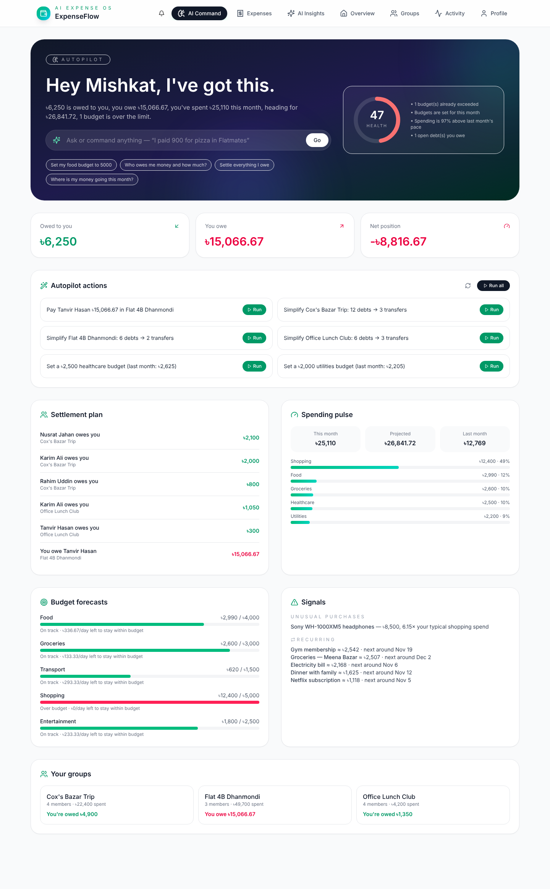
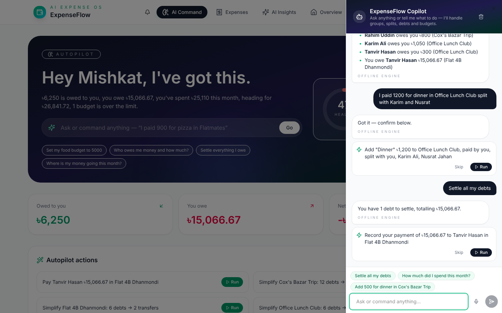
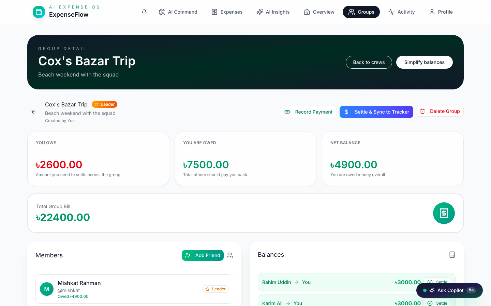
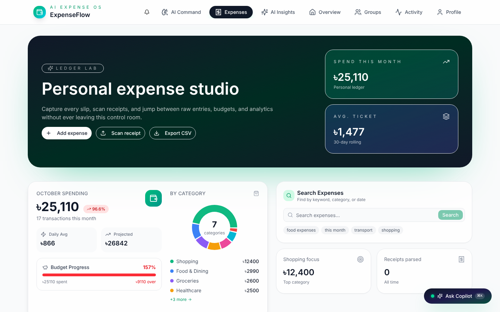
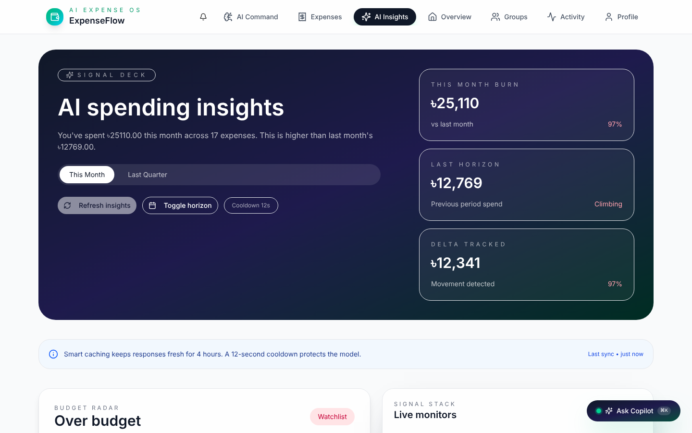
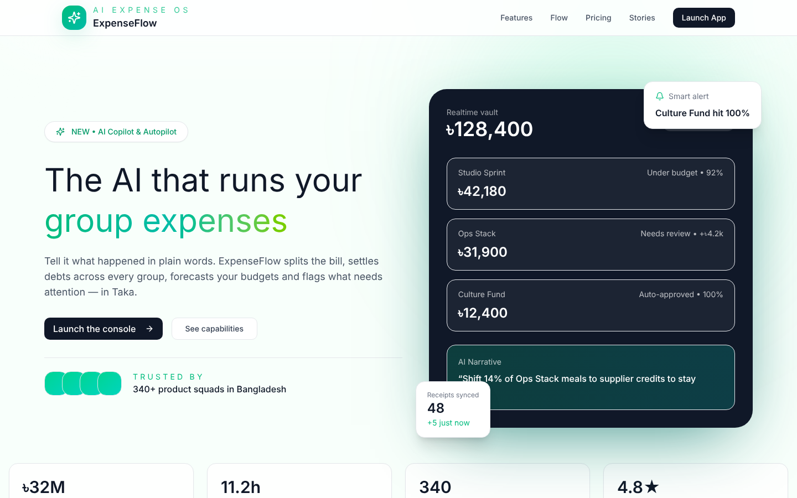
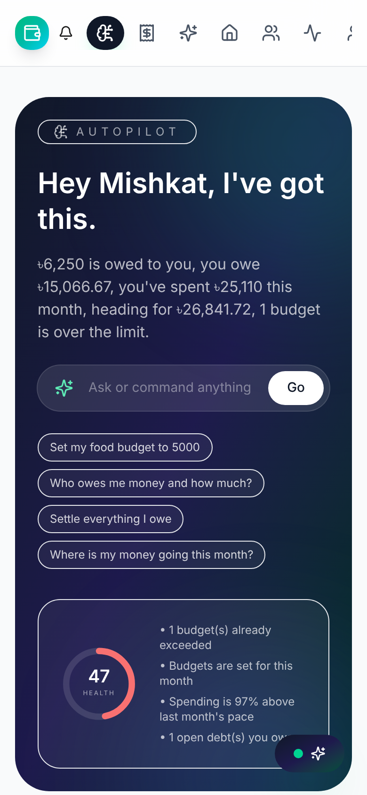
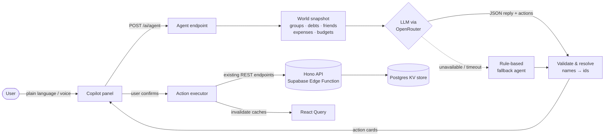

# ExpenseFlow AI

**An AI-run group expense manager.** Tell it what happened in plain words and it splits bills, settles debts across every group, forecasts budgets and flags what needs attention, in Bangladeshi Taka (৳).




---

## Highlights

### 🤖 AI Copilot: chat that takes action
Open it from anywhere with the floating button or <kbd>⌘/Ctrl</kbd> + <kbd>K</kbd>, then type or **speak**:

| You say | Copilot does |
|---|---|
| *"I paid 1200 for dinner in Office Lunch Club, split with Karim and Nusrat"* | Adds a group expense, paid by you, split equally to the paisa between 3 people |
| *"Settle all my debts"* | Works out the minimum payments across **every** group and prepares one payment action per debt |
| *"Set my food budget to 5000"* | Creates this month's budget |
| *"Create a group called Flatmates with Rahim and Tanvir"* | Creates the group and adds both friends |
| *"Who owes me money?"* / *"How much did I spend this month?"* | Answers from your live data, with names and amounts |
| *"Open Cox's Bazar Trip"* | Takes you straight to that group |

Every change shows up as an **action card** that you run or skip. Nothing changes until you confirm. Navigation is the only thing that happens automatically.

### 🧭 Autopilot: one briefing for every group
The **AI Command** page is the home screen. It reads all your groups, friends, personal expenses and budgets at once and shows:

- **Net position**: what you're owed, what you owe, and the net across all groups
- **Settlement plan**: each group's debts netted and simplified into a handful of transfers
- **One-click Autopilot actions**: pay what you owe, simplify group debts, and set budgets for categories that don't have one yet
- **Budget forecasts**: burn-rate projection to month end, plus how much you can spend per day and stay within budget
- **Signals**: unusual one-off purchases and recurring bills, with the next expected date
- **Financial health score** (0–100), with the reasons behind it

### 💸 The rest of the app
- Groups with **7 split strategies**: equal, unequal, percentage, custom percentage, itemised, who-joined, by-duration
- Payment recording, debt simplification, and syncing settled group bills to your personal ledger
- Personal expenses, budgets, trend analytics and CSV export
- **AI receipt scanning** (vision model) and **natural-language search**
- AI spending insights, plus an in-app notification system

---

## Screenshots

> Captured from the running app with a demo dataset.

| AI Copilot | Group detail |
|---|---|
|  |  |

| Personal expenses | AI spending insights |
|---|---|
|  |  |

| Landing page | Mobile |
|---|---|
|  |  |

---

## How it works



**The agent loop**

1. **Snapshot.** The edge function builds a compact model of everything the user can see: groups with members and who owes whom, friends, recent expenses, budgets, and the Autopilot analysis.
2. **Reason.** The LLM gets the snapshot, the conversation, and a catalogue of 10 actions. It replies with strict JSON: `{ reply, actions[], suggestions[] }`.
3. **Validate.** `normalizeAction()` turns names like "Karim" or "goa trip" into real ids, checks group membership and amounts, computes exact splits, and writes a plain-English summary. Invalid actions are reported to the user instead of being run.
4. **Confirm and execute.** The client shows action cards. Confirmed actions call the **existing** REST endpoints, so the AI goes through the same validation and balance logic as the UI. Then the React Query caches refresh.

**Design decisions**

- **Human in the loop.** The model proposes and the user confirms. A confused model can never move money on its own.
- **One source of business rules.** The AI has no write path of its own. It reuses `POST /groups/:id/expenses`, `/payments` and the other existing endpoints.
- **Works without AI.** If the model is unavailable or slow (25s timeout), a rule-based agent handles the common commands, and the UI labels these replies "Offline engine". The Autopilot is entirely rule-based, so its numbers come from your data, not from a model.

**Software design patterns** used in the codebase:

| Pattern | Where |
|---|---|
| Strategy | Split strategies (`src/supabase/functions/server/strategies`) and notification delivery strategies (`src/utils/notifications/strategies`) |
| Observer | `ExpenseObservable`, `NotificationObservable` |
| Factory | `NotificationFactory` |
| Chain of Responsibility | `DeliveryChain` (multi-channel or fallback delivery, chosen by priority) |
| Repository | `ExpenseRepository` / `IExpenseRepository` |

---

## Tech stack

| Layer | Tech |
|---|---|
| Frontend | React 18, TypeScript, Vite 6, Tailwind CSS 4, Radix UI / shadcn-style components, Motion, Recharts |
| Data fetching | TanStack React Query (caching, optimistic updates, invalidation) |
| Backend | Supabase Edge Function (Deno) with Hono, and a Postgres-backed key-value store (`kv_store_f573a585`) |
| Auth | Supabase Auth |
| AI | OpenRouter (chat and vision models) behind a rate limiter with retries and a rule-based fallback |

## Project structure

```
├── index.html
├── src/
│   ├── App.tsx                         # App shell, routing, Copilot provider
│   ├── components/
│   │   ├── copilot/CopilotPanel.tsx    # AI Copilot chat, action cards, voice, ⌘K
│   │   ├── pages/CommandCenterPage.tsx # Autopilot briefing (home)
│   │   ├── pages/…                     # Expenses, Groups, Friends, Activity, Insights, Profile, Landing
│   │   ├── groups/ expenses/ friends/  # Feature components (dialogs, lists, split UI)
│   │   └── ui/                         # Reusable UI primitives
│   ├── hooks/                          # React Query data hooks (useOptimized*)
│   ├── utils/
│   │   ├── api.ts                      # Typed REST client
│   │   ├── ai/agentActions.ts          # Executes Copilot actions via the REST client
│   │   ├── notifications/              # Notification system (Factory / Strategy / Observer / Chain)
│   │   └── observers/                  # Expense observer
│   └── supabase/functions/server/      # Split strategies & repository modules with unit tests
└── supabase/functions/make-server-f573a585/
    ├── index.ts                        # Hono API: auth, groups, friends, expenses, budgets, AI
    ├── copilot.ts                      # AI agent, action validation, Autopilot engine
    └── kv_store.tsx                    # Postgres KV helpers
```

## Getting started

**Prerequisites:** Node.js 18+ and npm. For the backend you also need the [Supabase CLI](https://supabase.com/docs/guides/cli).

```bash
npm install
```

```bash
npm run dev
```

The dev server runs at <http://localhost:3000>. For a production build in `build/`:

```bash
npm run build
```

The frontend talks to the Supabase project set in `src/utils/supabase/info.tsx`.

### Deploying the backend

```bash
supabase functions deploy make-server-f573a585
```

```bash
supabase secrets set OPENROUTER_API_KEY=your-key
```

`OPENROUTER_API_KEY` is **optional**. Without it, the Copilot runs on its rule-based engine and AI insights fall back to local analysis.

## API overview

All routes are prefixed with `/functions/v1/make-server-f573a585` and require a Supabase access token, except the auth routes.

| Method | Route | Purpose |
|---|---|---|
| `POST` | `/ai/agent` | Copilot: `{ messages, page }` → `{ reply, actions, suggestions, aiPowered }` |
| `GET` | `/ai/autopilot` | Cross-group briefing, forecasts, signals, health score, actions |
| `GET` | `/ai/insights` | AI spending insights (cached) |
| `POST` | `/scan-receipt` | Extract expense data from a receipt image |
| `GET` | `/search?q=` | Natural-language expense search and analytics |
| `GET/POST` | `/groups`, `/groups/:id` | List, create and read groups |
| `POST` | `/groups/:id/expenses` · `/payments` · `/simplify` · `/settle` | Group money operations |
| `GET/POST` | `/friends`, `/friends/add`, `/friends/settle` | Friends and one-to-one balances |
| `GET/POST/DELETE` | `/personal-expenses`, `/budgets` | Personal ledger and budgets |

---

Made with ❤️ in Bangladesh.
